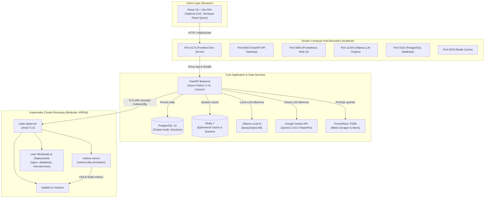
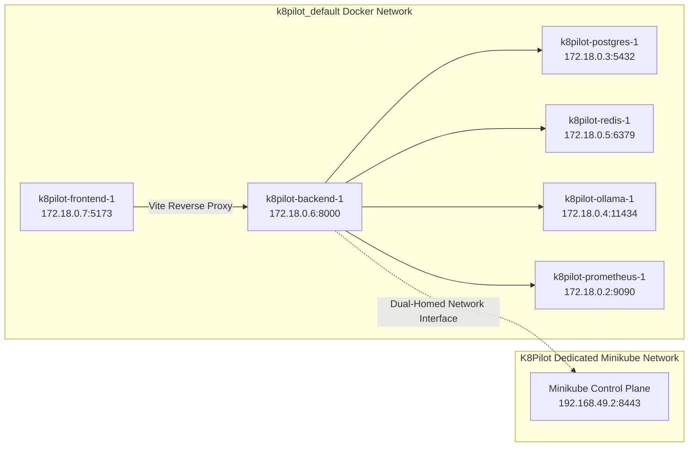
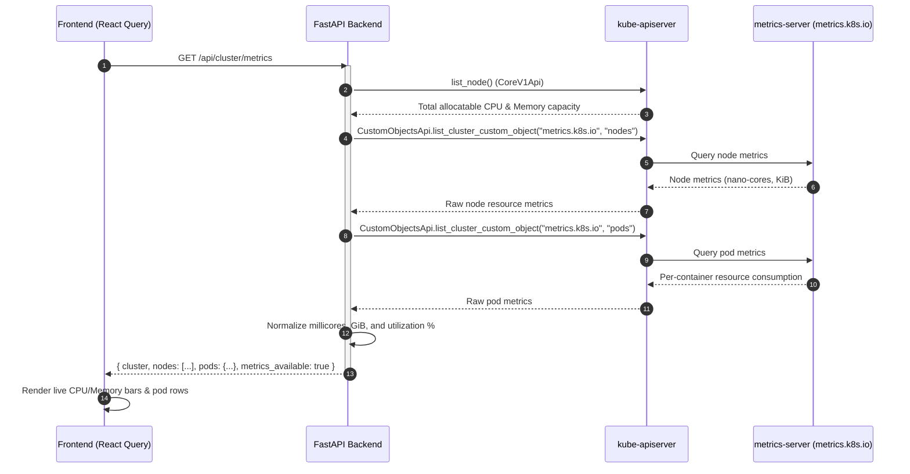
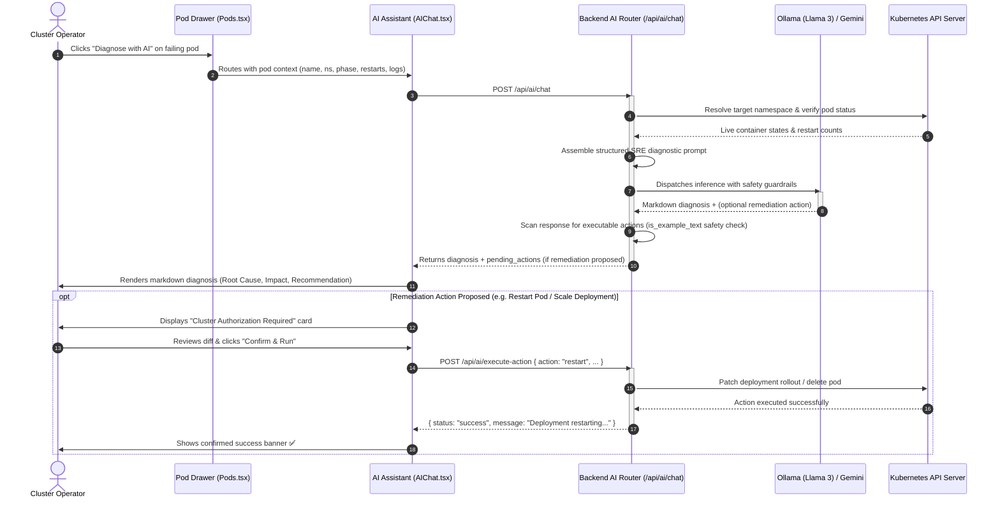
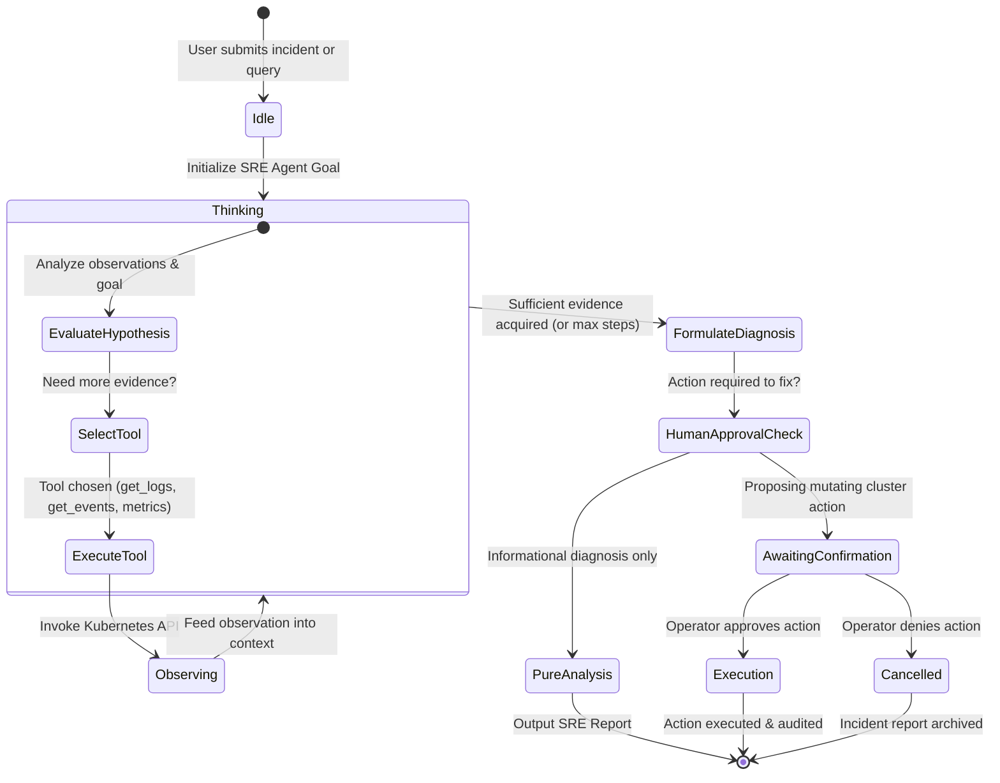
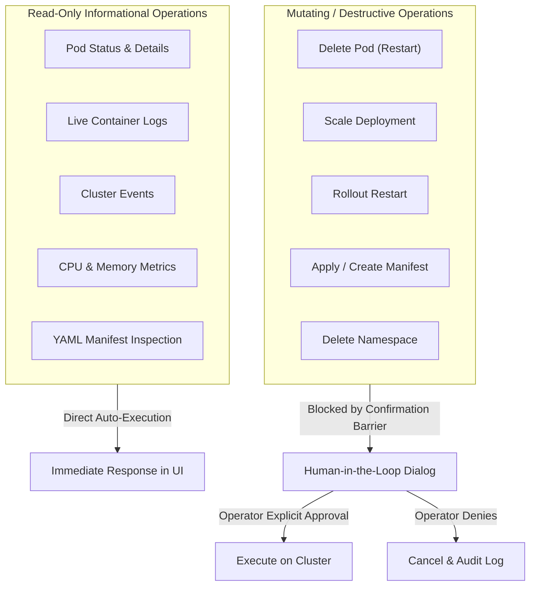

# K8Pilot – System Architecture & Engineering Design

This document provides a comprehensive technical overview of **K8Pilot**, an AI-powered Cloud Operations & Kubernetes Management Platform ("AI DevOps Engineer").

---

## 1. High-Level Architecture Overview

---

## 2. Container Networking & Docker Bridge Topology

K8Pilot bridges standard containerized development services with the isolated Minikube container runtime network:

> **Network Isolation Note**: The backend container joins both `k8pilot_default` and `K8Pilot` networks, giving it direct connectivity to the Minikube API server at `https://192.168.49.2:8443` without routing through host loops.

---

## 3. Real-Time Observability & Metrics Lifecycle

Live utilization gauges on the Dashboard and the Pods view query the Kubernetes Metrics API rather than relying solely on heavyweight external exporters:

---

## 4. SRE Diagnostic & Incident Investigation Lifecycle

When an operator clicks **"Diagnose with AI"** from the Pod Drawer or Dashboard warning stream, the platform follows a structured diagnostic flow with strict human-in-the-loop verification:

---

## 5. Autonomous SRE Agent Architecture (ReAct Loop)

For multi-step autonomous troubleshooting (Phase 4), K8Pilot utilizes a ReAct (Reasoning + Acting) execution loop:

---

## 6. Subsystem & Component Details

### Frontend Architecture
* **Stack**: React 18, Vite, TypeScript, Tailwind CSS, Lucide Icons.
* **State & Caching**: TanStack React Query with automated background invalidation (`refetchInterval: 10000ms`).
* **Routing**: React Router DOM (`/` Dashboard, `/pods` Pods & Log Drawer, `/ai` AI Chat Assistant).
* **Hot Reloading**: Polling-enabled Vite dev server (`usePolling: true`) for instant Windows-to-Docker live sync.

### Backend Architecture
* **Framework**: FastAPI (Async Python 3.12).
* **API Modules**:
  - `cluster.py`: Cluster status, nodes, namespaces, pods, deployments, live metrics, cluster events.
  - `actions.py`: Pod deletion, deployment scaling, rollout restarts, pod log streaming.
  - `ai.py`: Multi-turn chat, prompt dispatching, action extraction, Ollama model pulling, Gemini API integration.
  - `health.py`: Deep health check across Redis, Prometheus, and Ollama.
* **Kubernetes Client**: Official `kubernetes` Python SDK with `CustomObjectsApi` for Metrics API support.

### AI Engine Layer
* **Local Inference**: Ollama (`llama3:latest` 8B parameter model running locally on CPU/GPU via Docker).
* **Cloud Inference**: Google Gemini API (supporting `gemini-2.0-flash`, `gemini-2.5-pro`, `gemini-1.5-flash` with client-provided API keys).
* **Action Guardrails**: Brace-depth JSON action extractor combined with natural language safety checks to prevent example code from executing against live clusters.

---

## 7. Security & Safety Model

